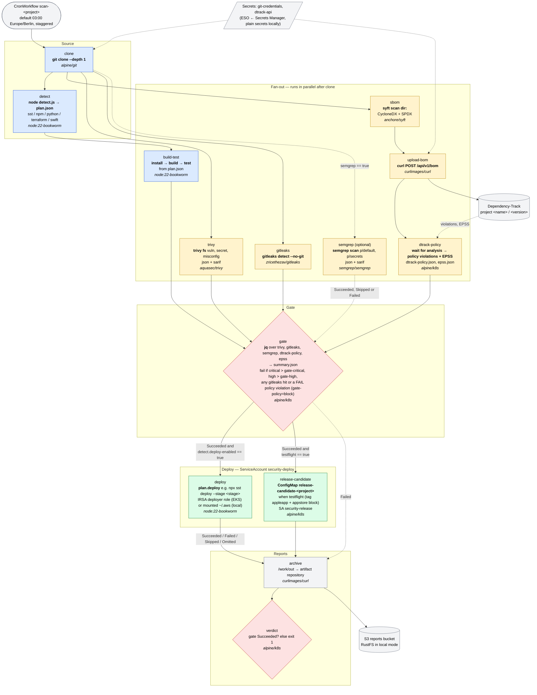
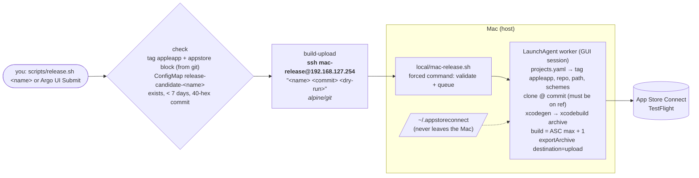
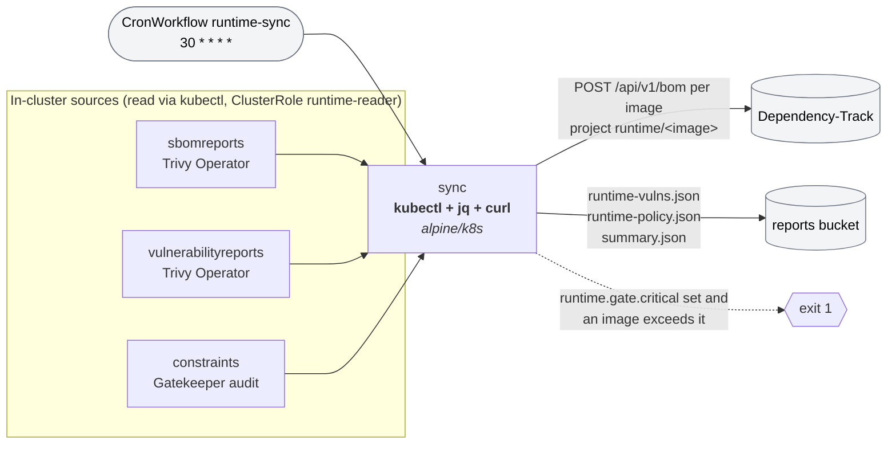
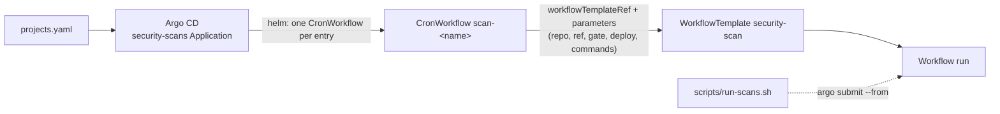

# Scan workflow (Argo Workflows)

What one run of the `security-scan` WorkflowTemplate does, which tool runs in each step and in which
image. Source of truth: `charts/security-scans/templates/workflowtemplate.yaml`; detection logic in
`charts/security-scans/files/detect.js`. Every entry in `projects.yaml` becomes one CronWorkflow
(`scan-<name>`) that references this template, so the DAG below is identical for every repo.

## Per-repo scan DAG

### Tools and images per step

| Step | Tool / command | Image (`values.yaml` → `images.*`) | ServiceAccount |
|---|---|---|---|
| clone | `git clone --depth 1 --branch <ref>` | `git` (alpine/git) | security-scan |
| detect | `node /detect/detect.js` → `plan.json`, `deploy-enabled.txt` | `runner` (node:22-bookworm) | security-scan |
| build-test | `plan.install`, `plan.build`, `plan.test` (npm ci / pip / terraform validate …) | `runner` | security-scan |
| sbom | `syft scan dir:/work/src` → CycloneDX + SPDX | `syft` | security-scan |
| upload-bom | `curl POST $DTRACK_URL/api/v1/bom` (autoCreate) | `curl` | security-scan |
| dtrack-policy | poll `/api/v1/event/token`, read `/violation/project` + `/finding/project` → `dtrack-policy.json`, `epss.json` | `k8s` | security-scan |
| trivy | `trivy fs --scanners vuln,secret,misconfig` (json + sarif) | `trivy` | security-scan |
| gitleaks | `gitleaks detect --no-git --redact` | `gitleaks` | security-scan |
| semgrep | `semgrep scan --config p/default --config p/secrets` (json + sarif) | `semgrep` | security-scan |
| gate | `jq` over the scanner output → `summary.json`, exit 1 on threshold breach | `k8s` (alpine/k8s) | security-scan |
| release-candidate | `kubectl apply` ConfigMap `release-candidate-<project>` (commit, summary) | `k8s` | **security-release** |
| deploy | `plan.deploy`, e.g. `npx sst deploy --stage <stage>` | `runner` | **security-deploy** |
| archive | collects `/work/out` as the `reports` artifact | `curl` | security-scan |
| verdict | fails the workflow when the gate did not succeed | `k8s` | security-scan |

All steps share one `work` PVC (`defaults.workspaceSize`, 10Gi); scanner output lands in `/work/out`.

### Why `verdict` exists

`archive` depends on `gate.Failed` so reports are stored even when the gate blocks. Argo then treats
the failed gate as expected and would mark the workflow *Succeeded*. `verdict` reads `tasks.gate.status`
and exits non-zero when it is not `Succeeded`, so a blocked run shows up red.

## Upload to TestFlight (manual, `upload-to-testflight` WorkflowTemplate, local mode)

The cluster SSH key is pinned in `authorized_keys` with `restrict,command="…/mac-release.sh",from="127.0.0.1,::1"`,
so it can start a release of a configured, enabled app and nothing else.

## Runtime sync (hourly, `runtime-sync` CronWorkflow)

Independent of the per-repo scans. Reads what Trivy Operator and Gatekeeper already produced in the
cluster and pushes it to the same sinks.

## How a run is created

Parameter precedence inside `detect`: auto-detection < `.security-pipeline.json` in the repo <
`commands:` in `projects.yaml`.
